<div align="center">

# 🍽️ WAKRO Digital — POS & Self-Order Warung WakRo Baru

**Point of Sale, self-order QR meja, layar dapur (KDS), dan dashboard owner yang tersinkron untuk Warung WakRo Baru.** Dibangun di atas basis kode KASA POS.

[](https://react.dev/)
[](https://www.typescriptlang.org/)
[](https://vitejs.dev/)
[](https://tailwindcss.com/)
[](https://dexie.com/)
[](https://web.dev/progressive-web-apps/)
[](LICENSE)

<br/>

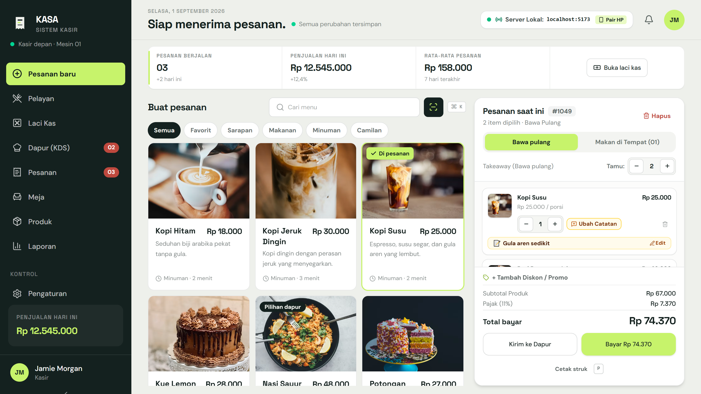

</div>

---

## 🧭 Alur Operasional WAKRO

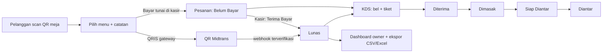

| Peran | Halaman | Fungsi utama |
|---|---|---|
| Pelanggan (tanpa login) | `/order/<id-meja>` | Pilih lantai & meja, pesan dengan catatan, bayar QRIS atau tunai di kasir, pantau progres, struk digital |
| Dapur (`dapur`) | `/dapur` | Bel pesanan baru, tiket FIFO dengan lantai/meja/catatan/status bayar, `Mulai Masak` ➔ `Selesai & Ready` ➔ `Sudah Diantar` |
| Kasir (`kasir`, `admin`) | `/`, `/meja`, `/pesanan` | Input walk-in/takeaway, denah meja per lantai (hijau kosong / amber terisi), terima pembayaran pesanan yang sudah ada, cetak struk thermal |
| Owner (`manajer`) | `/laporan`, `/produk` | Omset, jumlah & rata-rata transaksi, produk terlaris, grafik, riwayat transaksi, ekspor CSV/Excel, stok produk jadi |

Aturan yang dijaga server (Worker + D1):

- **Dua status terpisah.** `paymentStatus` (`unpaid` ➔ `paid`) dan `kitchenStatus` (`queued` ➔ `preparing` ➔ `ready` ➔ `served`). Pesanan yang sudah diantar tetap `Belum Bayar` sampai kasir atau gateway melunasinya.
- **Pelunasan pesanan yang sama.** `POST /api/orders/{no}/payment` melunasi pesanan self-order/pelayan tanpa membuat pesanan baru. Pembayaran ulang dikembalikan sebagai `alreadyPaid` tanpa pencatatan ganda.
- **Anti pesanan ganda.** Setiap submit membawa `clientRef` acak; retry dengan kunci yang sama mengembalikan pesanan pertama. Tombol submit dikunci selama proses.
- **Stok siap jual atomik.** `products.stock` (`NULL` = tidak dilacak) berkurang dalam batch yang sama dengan pesanan. Constraint `stock >= 0` membatalkan seluruh pesanan jika stok habis karena pesanan bersamaan. Stok `< 5` tampil sebagai peringatan; `0` mengunci menu sebagai **HABIS**. Riwayat perubahan tersimpan di `stock_movements`.
- **Identitas meja stabil.** Pesanan menyimpan `table_id`; lantai berasal dari `restaurant_tables.area` (`Lantai 1`, `Lantai 2`, `Rooftop`). QR meja berisi `/order/<id-meja>`. Meja dengan pesanan aktif atau belum dibayar tidak dapat dihapus.
- **Akses pelanggan.** Status dan struk digital hanya bisa dibaca dengan kunci rahasia yang dibuat perangkat pelanggan saat memesan (`GET /api/public/orders/{no}?key=…`).

### QRIS self-payment (Midtrans)

QRIS mandiri pelanggan **nonaktif** sampai `MIDTRANS_SERVER_KEY` diisi. Tanpa key, pelanggan hanya dapat memilih bayar tunai di kasir.

```bash
cd client
pnpm exec wrangler secret put MIDTRANS_SERVER_KEY       # Server Key dari dashboard Midtrans
# Opsional, untuk akun produksi:
pnpm exec wrangler secret put MIDTRANS_IS_PRODUCTION     # isi: true
```

Atur **Payment Notification URL** di dashboard Midtrans ke `https://<domain>/api/payments/midtrans/notify`. Pesanan hanya menjadi lunas bila signature notifikasi valid **dan** status transaksi yang dibaca ulang dari API Midtrans adalah `settlement`/`capture` dengan nominal yang sama. QR berlaku 15 menit; QR baru dibuat otomatis setelah kedaluwarsa.

Untuk uji lokal, `wrangler dev` hanya memuat secret yang terdaftar di `secrets.required`; berikan variabel QRIS dengan `--var`, misalnya `pnpm exec wrangler dev --var MIDTRANS_SERVER_KEY:<sandbox-key>`. `MIDTRANS_API_BASE` dapat menunjuk ke mock lokal.

QRIS di layar kasir dan mode pelayan adalah **QRIS statis toko dengan verifikasi manual**: kasir menekan konfirmasi hanya setelah notifikasi dana masuk muncul di aplikasi merchant. Mode demo lokal (`VITE_DATA_SOURCE=local`) memakai simulasi QRIS yang diberi label demo.

---

## 🌟 Ringkasan Keunggulan

KASA (basis WAKRO Digital) dirancang untuk operasional kuliner yang membutuhkan **kecepatan tinggi dan kolaborasi multi-perangkat**.

- ⚡ **Dua mode data**: mode demo lokal menyimpan data di IndexedDB satu browser (sinkron antar-tab, **bukan** antar-perangkat). Untuk operasional multi-perangkat (HP pelanggan, tablet dapur, kasir) gunakan build Cloudflare (Worker + D1); perangkat staf memuat ulang data setiap 5 detik dan pelanggan memantau pesanannya sendiri. Mode ini membutuhkan koneksi ke server.
- 📱 **QR Self-Order Meja**: Pelanggan memindai QR di meja mereka, memilih menu, dan pesanan langsung masuk ke antrean dapur secara otomatis.
- 👨‍🍳 **Kitchen Display System (KDS)**: Antrean memasak visual untuk koki dengan indikator waktu, kartu tiket multi-pelayan, dan update status real-time.
- 🚶 **Mode Pelayan Keliling (Waitstaff)**: Antarmuka mobile responsif dengan isolasi keranjang per pelayan dan indikator pencegahan tabrakan meja (*Table Lock*).
- 🔫 **Multi-Engine Barcode & QR Scanner**: Mendukung *Hardware Scanner Gun* USB/Bluetooth HID, pemindai kamera ZXing (1D/2D), unggah gambar, dan audio beep sintetis Web Audio API.
- 👥 **Role-Based Access Control (RBAC)**: Proteksi PIN 4 digit untuk Kasir/Admin, Pelayan, Dapur, dan Manajer dengan pembatasan hak akses rute (*RouteGuard*).
- 🖨️ **Thermal Receipt Printer Bluetooth & USB**: Driver ESC/POS biner untuk kertas 58mm & 80mm via Web Bluetooth API tanpa aplikasi pihak ketiga.

## 🎨 Konsep Desain UI/UX — Claymorphism KASA

Tampilan memakai **claymorphism** untuk memberi kesan permukaan lembut, tactile, dan mudah dipindai tanpa mengubah fungsi operasional:

| Aspek | Keputusan | Alasan |
|---|---|---|
| Konsep visual | Claymorphism: permukaan putih, canvas biru langit, bevel lembut, shadow dua arah | Kontrol terasa bisa disentuh; hierarki terlihat tanpa panel kaca |
| Tata letak | Sidebar desktop + bottom nav mobile | Akses satu-jempol di HP, navigasi cepat di desktop |
| Palet utama | Sky blue `#a9d2f3`, ceramic white `#ffffff`, navy ink `#172b4d`, action blue `#2d6cdf` | Mengikuti kombinasi biru-putih referensi dengan kontras kerja yang jelas |
| Aksen status | Biru aksi, mint siap, coral urgent, butter antrean | Status tetap dibantu teks dan ikon, bukan warna saja |
| Tactile system | Shadow luar untuk permukaan, shadow inset untuk field, pressed state pada kontrol | Membedakan surface, input, dan aksi secara konsisten |
| Tipografi | Trebuchet MS (display + body) | Bentuk humanis dan rounded, tersedia tanpa font eksternal sehingga tetap offline-first |
| Sentuhan | Minimal 44px, focus visible, reduced motion | Aksesibilitas dan penggunaan kasir saat operasional |
| State | Empty, loading, error, success terpisah | Pengguna tidak pernah bingung apa yang terjadi |
| Hardware | Scanner, printer thermal, Bluetooth tetap diaktifkan | Path hardware tetap jalan tanpa app pihak ketiga |

Semua fitur asli (kasir, KDS, pelayan, QR self-order, laporan, laci kas) tetap utuh — hanya bahasa visualnya dirombak menjadi claymorphism.

## 💳 Alur Pembayaran & Dapur

Pembayaran dan proses dapur memakai dua lifecycle terpisah agar status operasional tidak rancu:

| Lifecycle | Status |
|---|---|
| Pembayaran | `unpaid` → `paid` → `refunded` |
| Dapur | `draft` → `queued` → `preparing` → `ready` → `served` |

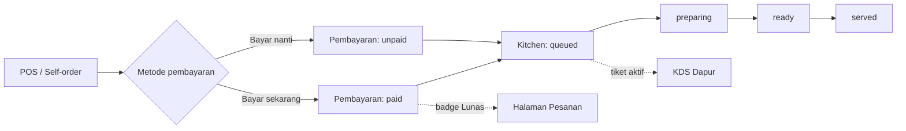

Perilaku transaksi:

- **Bayar & Kirim ke Dapur** adalah aksi utama pada POS. Setelah pembayaran berhasil, pesanan otomatis masuk antrean KDS.
- **Kirim ke Dapur** tetap tersedia untuk pesanan bayar nanti atau pesanan yang belum dibayar.
- **Self-order bayar langsung** otomatis masuk antrean dapur setelah pembayaran.
- **Self-order bayar nanti** masuk antrean dapur dan pembayaran diselesaikan kemudian.
- Halaman Pesanan menampilkan status operasional dapur dan badge pembayaran **Lunas** secara terpisah.
- Data lama yang hanya memiliki `status` tetap dibaca melalui fallback kompatibilitas.

---

## 🛠️ Teknologi yang Pertahankan
- React 19 + TypeScript + Vite + Tailwind CSS v4 (SPA offline-first)
- Dexie / IndexedDB sebagai sumber data lokal primer
- BroadcastChannel + localStorage sinkronisasi multi-perangkat LAN
- PWA + Service Worker untuk instalasi di layar utama
- Web Bluetooth ESC/POS, ZXing barcode scanner, Web Audio beep

### Sumber Data

KASA mendukung dua mode:

- `local`: mode demo/offline. Data dummy tetap disimpan di IndexedDB dan ditampilkan.
- `remote`: produk, order, meja, kategori, shift, dan mutasi kas dibaca dari API Laravel yang terhubung ke MySQL. Data dummy tetap ada di IndexedDB sebagai data lokal lama, tetapi tidak dipakai untuk tampilan utama.

Aktifkan mode remote dengan membuat `client/.env`:

```env
VITE_DATA_SOURCE=remote
VITE_API_URL=/api
```

Vite meneruskan `/api` ke Laravel pada `http://127.0.0.1:8000` saat development.

---

## 📋 Rencana Implementasi Bertahap (Fase)

| Fase | Fokus | Status |
|---|---|---|
| 1 | Design tokens & komponen primitif UI | ✅ Selesai |
| 2 | Layout skeleton & navigasi (Sidebar, Header, MobileNav, AppLayout) | ✅ Selesai |
| 3 | POS kasir utama & keranjang (Home, CartPanel) | ✅ Selesai |
| 4 | Layar dapur / KDS (Kitchen) | ✅ Selesai |
| 5 | Mode pelayan keliling (WaiterOrder) | ✅ Selesai |
| 6 | QR self-order pelanggan (CustomerSelfOrder) | ✅ Selesai |
| 7 | Laporan & laci kas (Reports, CashDrawer) | ✅ Selesai |
| 8 | Pengaturan & pusat jaringan (Settings, NetworkHub) | ✅ Selesai |
| 9 | Hardening, aksesibilitas, E2E, dokumentasi | ✅ Selesai |

Setiap fase diverifikasi dengan `tsc --noEmit` dan `vite build` sebelum melanjutkan.

---

## 🧪 Verifikasi

```bash
cd client
npm run check      # TypeScript (harus 0 error)
npm run build      # Vite production build
```

Skenario workflow pembayaran yang diverifikasi di browser:

1. Tambahkan item ke keranjang POS.
2. Pilih **Bayar & Kirim ke Dapur**.
3. Selesaikan pembayaran tunai, kartu/QR, atau QRIS.
4. Pastikan modal pembayaran tertutup dan transaksi baru dibuat.
5. Buka `/dapur` dan pastikan tiket pesanan muncul di antrean KDS.
6. Buka `/pesanan` dan pastikan badge **Lunas** muncul tanpa menghilangkan status dapur.

Build menghasilkan warning ukuran chunk JavaScript dari Vite, tetapi tidak ada error TypeScript, build, maupun runtime pada skenario tersebut.

---

## 📘 Handbook Operasional

Panduan lengkap untuk pemilik restoran dan tim operasional tersedia di:

- [KASA Handbook Operasional PDF](docs/KASA-Handbook.pdf)
- [Sumber handbook HTML](docs/KASA-Handbook.html)

## 📸 Galeri Antarmuka

| Modul | Tampilan Antarmuka |
| :--- | :--- |
| **Kasir Utama (POS)**<br/>*Pencarian instan, multi-cart, diskon, QRIS, & cetak struk* |  |
| **QR Self-Order Pelanggan**<br/>*Scan di meja, pesan menu, & lacak status masak live* | 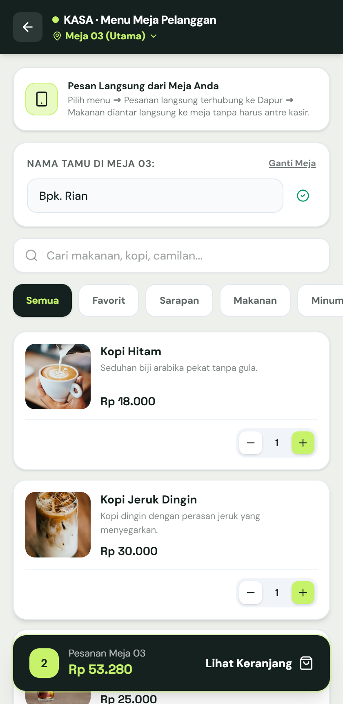 |
| **Layar Dapur (KDS)**<br/>*Tiket pesanan real-time, timer masak, & tombol siap saji* | 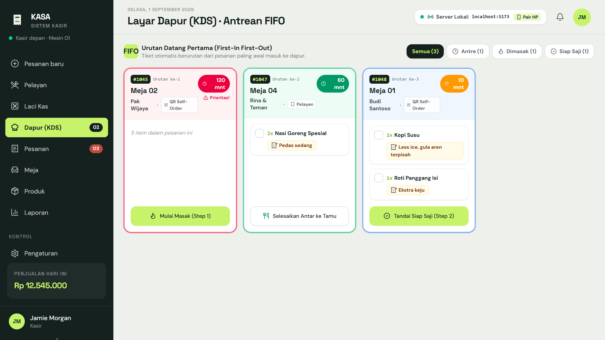 |
| **Mode Fokus Pelayan**<br/>*Input pesanan keliling, sesi terisolasi, & denah meja* | 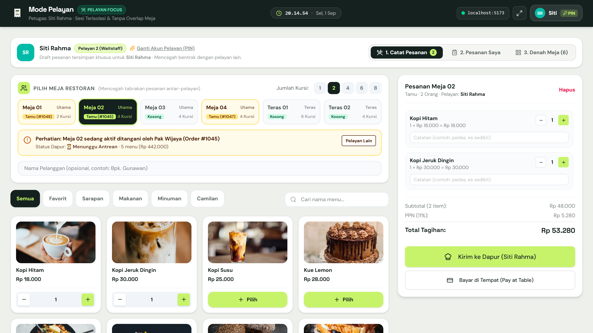 |
| **Pemindai Barcode & QR**<br/>*Kamera ZXing, Scanner Gun USB, audio beep, & keypad* | 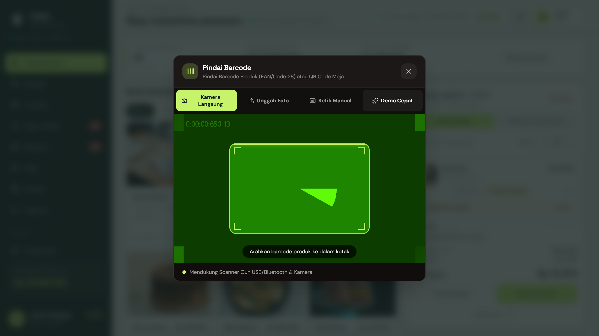 |
| **Pusat Jaringan & Sinkronisasi**<br/>*Pairing QR untuk HP pelayan, layar dapur, & WiFi meja* | 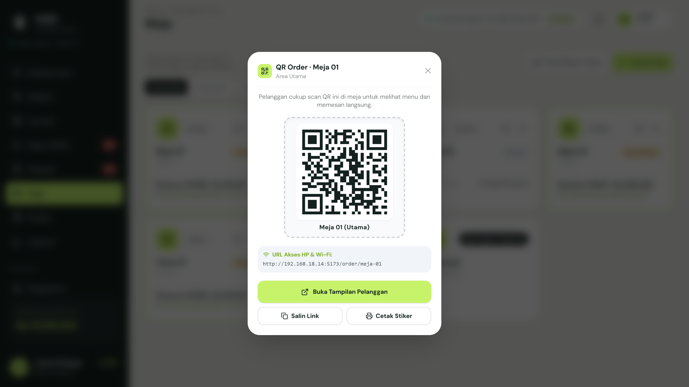 |
| **Laci Kas & Rekonsiliasi**<br/>*Perhitungan fisik uang laci vs rekap penjualan shift* | 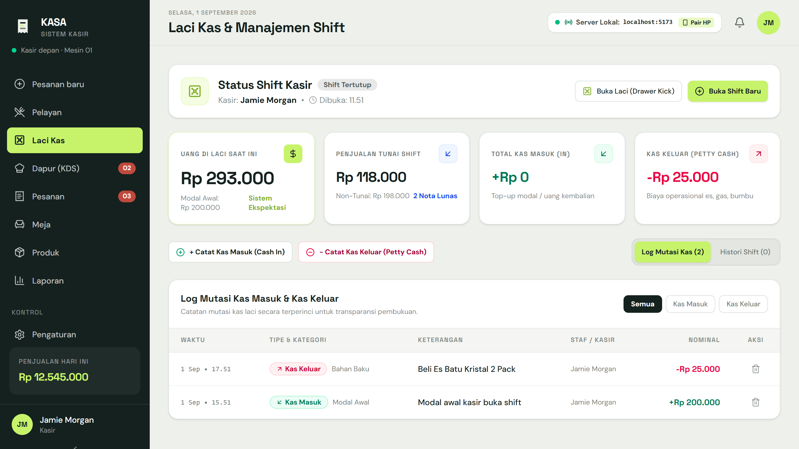 |
| **Katalog & Gambar Produk**<br/>*Upload foto lokal, pencarian Google, & galeri kuliner* | 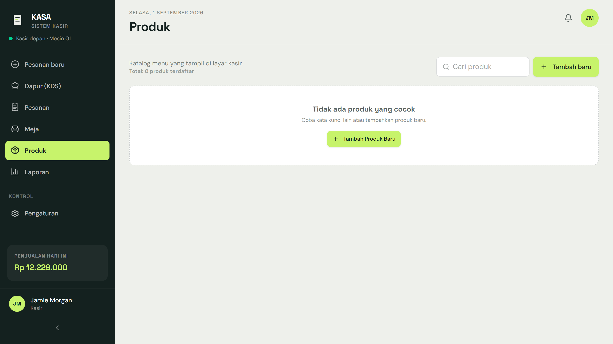 |
| **Manajemen Meja Restoran**<br/>*Denah area (Utama, VIP, Teras) & generator cetak QR Meja* | 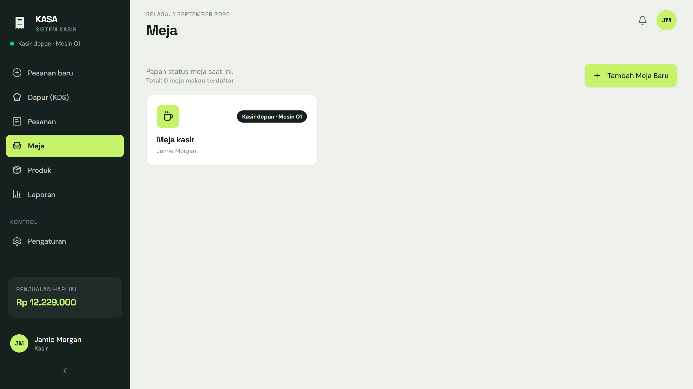 |
| **Laporan Penjualan**<br/>*Grafik omset, rekap metode bayar, & ekspor data Excel* | 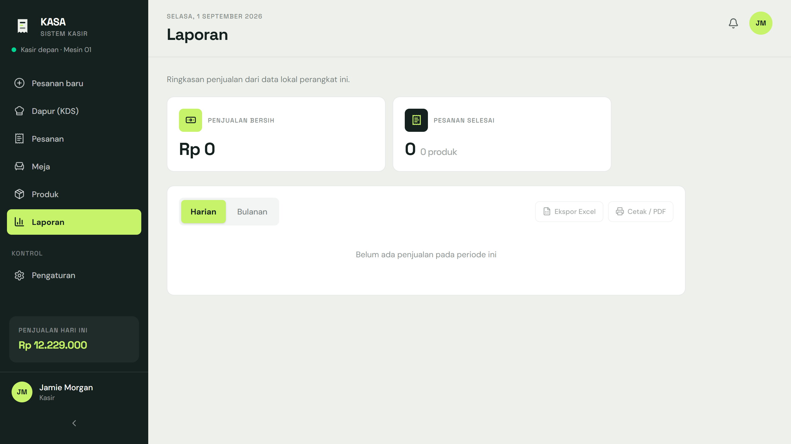 |

---

## 🔑 Akun & PIN Default (Role-Based Access)

Sistem dilengkapi tombol ganti akun cepat (*Quick Switch*) dengan proteksi PIN 4 digit:

| Nama Staf | Peran (*Role*) | PIN Default | Hak Akses Rute |
| :--- | :--- | :--- | :--- |
| **Jamie Morgan** | `Kasir & Admin` | `1234` | Akses penuh: POS, Meja, Produk, Laci Kas, Laporan, Pengaturan, Pelayan, Dapur |
| **Budi Santoso** | `Pelayan 1` | `2222` | Khusus Mode Pelayan (`/pelayan`) & Pesanan Meja |
| **Siti Rahma** | `Pelayan 2` | `2223` | Khusus Mode Pelayan (`/pelayan`) & Pesanan Meja |
| **Agus Pratama** | `Pelayan 3` | `2224` | Khusus Mode Pelayan (`/pelayan`) & Pesanan Meja |
| **Chef Junaedi** | `Kepala Dapur` | `3333` | Khusus Layar Dapur KDS (`/dapur`) |
| **Hendra Wijaya** | `Manajer` | `8888` | Dashboard Owner (`/laporan`), Stok Produk (`/produk`), Pesanan, Laci Kas, Pengaturan, & Meja |

---

## 🛠️ Fitur & Modul Utama

### 1. 🛒 Kasir & Transaksi POS (`/`)
- **Pencarian Cepat (`Ctrl + K`)**: Cari menu berdasarkan nama atau SKU barcode.
- **Multi-Tab Cart Meja**: Simpan draf transaksi di beberapa meja tanpa takut data hilang saat beralih.
- **Kustomisasi Pesanan**: Tambahkan catatan per item (*less sugar, tanpa bawang, pedas sedang*).
- **Kalkulasi Otomatis**: Subtotal, diskon (persen/nominal), biaya layanan (*Service Charge*), dan Pajak Pertambahan Nilai (PPN 11%).
- **Multi-Metode Pembayaran**: Tunai dengan kalkulator uang kembalian cepat, QRIS Dinamis Mandiri, Kartu Debit/Kredit, dan Transfer Bank.
- **Pembayaran atomik**: Aksi utama `Bayar & Kirim ke Dapur` mencatat pembayaran dan mengantrekan tiket KDS dalam satu alur.
- **Status terpisah**: Status pembayaran tidak menimpa status proses dapur, sehingga pesanan bisa `Lunas` sekaligus `Dimasak`.

### 2. 📲 QR Self-Order Pelanggan (`/order/:tableId`)
- **Tanpa Unduh Aplikasi**: Pelanggan cukup scan QR Code yang tertempel di meja makan mereka.
- **Bypass Kasir & Pelayan**: Pesanan langsung diteruskan ke Kitchen Display System (KDS) di dapur.
- **Live Cooking Status**: Pelanggan dapat memantau proses memasak (*Pesanan Diterima* ➔ *Sedang Dimasak* ➔ *Siap Diantar ke Meja*).
- **Opsi Bayar Fleksibel**: Pembayaran langsung di meja via QRIS atau opsi bayar di kasir saat selesai makan.

### 3. 👨‍🍳 Layar Dapur / Kitchen Display System (`/dapur`)
- **Realtime Ticket Queue**: Tiket pesanan masuk seketika dari kasir, pelayan, maupun pelanggan self-order.
- **Status operasional**: Tombol transisi cepat `Mulai Masak` ➔ `Siap Disajikan` ➔ `Selesai`; status pembayaran tetap terpisah.
- **Timer & Urgent Alert**: Penghitung waktu otomatis dengan tanda peringatan visual untuk pesanan di atas 15 menit.
- **Indikator Asal Pesanan**: Label jelas untuk membedakan pesanan Pelayan (Budi/Siti), Kasir, atau Self-Order Meja.

### 4. 🚶 Mode Pelayan Fokus (`/pelayan`)
- **Isolasi Draft**: Sesi keranjang tersimpan per staf (`kasa_waiter_cart_${staffId}`) mencegah tumpang tindih pesanan.
- **Table Lock Protection**: Memberi tahu jika meja tertentu sedang aktif ditangani oleh pelayan lain.
- **3 Tab Operasional**: *1. Catat Pesanan*, *2. Pesanan Saya (Active Orders)*, dan *3. Denah Meja (Layout)*.

### 5. 🔫 Sistem Barcode & QR Multi-Engine
- **Hardware Barcode Gun (USB / Bluetooth HID)**: Menangkap ketukan berkecepatan tinggi scanner fisik secara pasif di kasir tanpa perlu klik form.
- **Kamera Scanner (ZXing Multi-Format)**: Memindai barcode 1D (*EAN-13, EAN-8, Code 128, Code 39, UPC*) dan 2D (*QR Code, Data Matrix*) dengan algoritma `TRY_HARDER`.
- **Web Audio Beep**: Synthesizer audio asli (*high chime* saat sukses dan *low buzz* saat error) tanpa ketergantungan file audio eksternal.
- **4 Tab Pemindai**: *Kamera Langsung* (dengan targeting reticle dan laser), *Unggah Foto*, *Ketik Manual*, dan *Demo Cepat*.

### 6. 💵 Laci Kas & Rekonsiliasi Shift (`/laci-kas` & `/pengaturan`)
- **Buka Shift**: Pencatatan kasir bertugas dan modal awal uang kembalian.
- **Tutup Shift & Rekonsiliasi**: Input hitungan fisik uang kertas & koin, sistem otomatis membandingkan dengan total penerimaan tunai sistem dan mendeteksi selisih (pas, surplus, minus).
- **Riwayat Shift**: Log riwayat shift tersimpan rapi untuk kebutuhan pembukuan.

### 7. 🖨️ Hardware Thermal Receipt Printer (ESC/POS)
- **Web Bluetooth GATT**: Terhubung langsung ke printer thermal portable 58mm / 80mm tanpa driver software desktop.
- **Format Struk Lengkap**: Header nama resto, nomor meja/pelanggan, daftar pesanan + catatan, rincian diskon/pajak, QRIS, dan footer struk.
- **Fallback Cetak Standar**: Opsi dialog print browser (`window.print()`) untuk printer kabel USB/LAN.

### 8. 🌐 Pusat Jaringan & Panduan Server Lokal
- **Pairing QR Code**: Menampilkan IP jaringan lokal (contoh: `192.168.18.14:5173`) untuk menghubungkan HP pelayan dan tablet dapur dengan satu scan.
- **WiFi QR Generator**: Buat dan cetak kartu QR WiFi restoran untuk pelanggan.

---

## 🏗️ Struktur Arsitektur & Folder

```text
├── client/                      # Frontend SPA (React 19 + TypeScript + Vite + Tailwind 4)
│   ├── public/                  # Ikon PWA, manifest, favicon
│   ├── scripts/                 # Otomasi pengujian E2E & visual Puppeteer
│   └── src/
│       ├── components/          # Komponen UI, BarcodeScanner, CartPanel, RouteGuard, Modals
│       ├── hooks/               # Custom hooks (useBarcodeGunScanner, etc.)
│       ├── lib/                 # Database Dexie.js, Audio Feedback, Exporters, Sync Bus
│       ├── pages/               # Home (Kasir), WaiterOrder, Kitchen, CustomerSelfOrder,
│       │                        # CashDrawer, Orders, Tables, Products, Reports, Settings
│       └── services/            # ESC/POS binary encoder & Bluetooth GATT driver
├── docs/                        # Tangkapan layar antarmuka & dokumentasi panduan
├── server/                      # Backend opsional (Laravel 11 REST API)
└── capacitor/                   # Konfigurasi wrapper native Android/iOS
```

---

## 🚀 Panduan Instalasi & Menjalankan

### Kebutuhan Sistem
- **Node.js**: versi 18.0.0 atau lebih baru
- **Package Manager**: `npm`, `pnpm`, atau `yarn`
- **Browser Modern**: Google Chrome, Microsoft Edge, atau browser berbasis Chromium (disarankan untuk Web Bluetooth & Barcode Scanner API).

### 1. Clone Repository
```bash
git clone https://github.com/Akmal18Aqil/kasir-restoran.git
cd kasir-restoran
```

### 2. Jalankan Frontend KASA
```bash
cd client
npm install
npm run dev
```
Aplikasi kasir akan aktif di `http://localhost:5173`.

### 3. Jalankan API Laravel dan MySQL

Pastikan MySQL aktif dan database `kasir_restoran` sudah tersedia. Server Laravel membutuhkan PHP 8.3 atau lebih baru.

```bash
cd server
composer install
php artisan migrate
php artisan serve --host=127.0.0.1 --port=8000
```

Salin `server/.env.example` menjadi `server/.env`, lalu isi `DB_DATABASE`, `DB_USERNAME`, dan `DB_PASSWORD` sesuai MySQL lokal.

Untuk memakai data MySQL pada frontend, aktifkan `VITE_DATA_SOURCE=remote` sebelum menjalankan Vite.

### 4. Hubungkan Perangkat di Jaringan WiFi yang Sama
- Dapatkan alamat IP laptop kasir (misal: `http://192.168.1.10:5173`).
- Buka di HP Pelayan: `http://192.168.1.10:5173/pelayan`
- Buka di Tablet Dapur: `http://192.168.1.10:5173/dapur`
- Buka QR Meja Pelanggan: `http://192.168.1.10:5173/order/meja-01`

### 5. Build untuk Produksi
```bash
cd client
npm run build
```
Hasil build statis dan Service Worker PWA siap di-deploy di folder `client/dist`.

### Persiapan Cloudflare Workers dan D1

Worker dan migrasi D1 dapat diuji secara lokal dari direktori `client`:

```bash
pnpm install --frozen-lockfile
pnpm exec wrangler d1 migrations apply DB --local
pnpm run check:worker
pnpm exec wrangler deploy --dry-run
```

Build Worker menggunakan `VITE_DATA_SOURCE=remote`; jangan gunakan build mode lokal untuk deployment. Isi `SESSION_SECRET` dan `BOOTSTRAP_SECRET` melalui secret Worker atau `.dev.vars` yang tidak dikomit. Admin pertama dibuat melalui `/api/setup/bootstrap`; endpoint menerima secret bootstrap melalui header `X-Bootstrap-Secret`, dan `username`, `name`, serta `password` pada body JSON. Ganti secret bootstrap dengan nilai kurang dari 32 karakter setelah penyiapan untuk menonaktifkan endpoint.

Menu profil di header menampilkan pilihan pengelolaan staf untuk admin dan pilihan keluar atau ganti akun. Membuka menu tidak mengakhiri sesi.

Mode Cloudflare mengizinkan pelanggan memesan tanpa login lalu membayar tunai di kasir atau lewat QRIS Midtrans bila `MIDTRANS_SERVER_KEY` diisi (lihat bagian QRIS di atas). Pembayaran QRIS pada mode lokal adalah simulasi, bukan verifikasi pembayaran. Tarif pajak dan layanan disimpan di D1; pesanan ditolak jika total yang disetujui pelanggan berbeda dari total server atau stok tidak mencukupi. Migrasi `0002_wakro_operations.sql` (stok, `table_id`, idempotensi, pelunasan) dan `0003_qris_charges.sql` (charge QRIS) wajib diterapkan sebelum deploy: `pnpm exec wrangler d1 migrations apply DB --remote`. Data MySQL tidak otomatis disalin ke D1; cadangkan dan verifikasi data sumber sebelum cutover.

---

## 🧪 Pengujian Otomatis (E2E Testing)

KASA dilengkapi suite pengujian otomatis berbasis Puppeteer untuk memverifikasi fungsionalitas dan mencegah regresi visual:

```bash
cd client
node scripts/test-barcode-qr-fix.mjs     # Uji scanner kamera, demo, hardware gun, & table QR
node scripts/test-multi-waiter.mjs       # Uji sesi terisolasi multi-pelayan & table locking
node scripts/test-self-order.mjs         # Uji alur self-order meja ke KDS real-time
```

---

## 📄 Lisensi

Proyek ini dilisensikan di bawah lisensi **MIT License** — bebas digunakan dan dikembangkan untuk keperluan komersial maupun pribadi.
